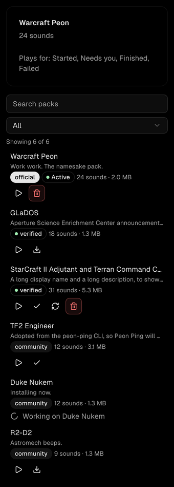

# Peon Ping

Character voice lines when your Orca agents finish, fail, or need you — Warcraft peons,
GLaDOS, StarCraft, Duke Nukem, and 380-odd more.

**macOS only in this version.** Linux and Windows playback are planned, not shipped —
see [Platform support](#platform-support) below before you install this on anything else.

## Why

Orca's own notification for an agent event is a small corner toast plus a short, quiet
system chime — and it's the *same* chime for every kind of event. If you're in a browser,
in Slack, or have music on, that toast goes unseen, and an agent can sit blocked on a
permission prompt for ten minutes before anyone notices.

Peon Ping replaces that with something you can't miss: loud, distinct, character voice
lines, with a different line depending on what happened. The sound alone tells you
whether to go look.



## Install

1. In Orca, open the plugin browser and install **Peon Ping** (`omar227.peon-ping`), or
   from a terminal:
   ```bash
   orca plugin install omar227.peon-ping
   ```
   (or, before it's in the catalog, `orca plugin install omar227/orca-peon-ping`).
2. Approve the access it asks for when prompted — see [Access requested](#access-requested)
   below.
3. Open the **Peon Ping** panel in the right sidebar. On first run the plugin installs the
   default pack (`peon`, the Warcraft III orc, ~2 MB) automatically; nothing else to do.
4. **Turn off Orca's own notification sound** in Orca's settings, so the system chime and
   the voice line don't both fire for the same event.

### Platform support

This version only plays sound on **macOS**, via `afplay`. On Linux and Windows the
plugin loads and the panel works — you can browse the registry, install packs, and
preview sounds — but no sound plays on agent events, and the panel says so plainly
instead of failing silently. Linux (`pw-play` / `paplay` / `ffplay` / `mpv` / `play` /
`aplay`) and Windows playback are designed for and documented as later work; see the
[design doc](docs/superpowers/specs/2026-11-18-orca-peon-ping-design.md#later-not-now).
They ship when someone who runs that platform can confirm they actually hear it — not
before.

## Using it

The panel shows the active pack, which of the five reachable sound categories it covers,
and a searchable, filterable list of every pack in the [OpenPeon registry](https://openpeon.com/)
(382 and counting). Each row offers a preview, an install/use action, and — for packs
this plugin installed itself — delete. Switching the active pack takes effect
immediately.

Settings (Orca Settings → Plugins → Peon Ping) let you set the master volume, mute
everything, toggle each event category independently, and control whether a desktop
notification fires as a fallback when a sound can't play (muted, unsupported platform,
missing category, or a playback failure).

## Event mapping

The worker watches Orca's `agent.status.changed` event and reacts to *transitions*, not
raw states, keyed per pane:

| Orca transition | CESP category |
|---|---|
| First `working` for a new session | `session.start` |
| A later `working` | `task.acknowledge` |
| Entry into `blocked` or `waiting` | `input.required` |
| `done` with `mainAgent.outcome: "success"` (or no outcome reported) | `task.complete` |
| `done` with `mainAgent.outcome: "failure"` | `task.error` |
| `done` with outcome `cancellation`, `interruption`, `superseded`, or `unconfirmed` | *silent* |

An interrupted or cancelled turn is silent on purpose: you pressed stop, you already know.

**Four CESP categories never fire from this plugin**, because Orca emits no signal they
could map to: `resource.limit`, `user.spam`, `session.end`, `task.progress`. If you're a
pack author and your `resource.limit` sound never plays in Orca, that's why — it isn't a
bug in the pack or the plugin, Orca simply doesn't tell us when an agent hits a resource
limit, spams, ends a session, or makes incremental progress. CESP expects partial
coverage, and the panel shows which of the five *reachable* categories the active pack
actually covers.

### A deliberate limitation: blocked and waiting sound the same

Orca reports `blocked` and `waiting` as distinct states, but its own sidebar collapses
them into one "permission" status — there's no field that separates "please review this
plan" from "please approve this tool call." Rather than add a `terminal:read` capability
and guess the difference by reading terminal text, this plugin stays honest to what Orca
actually reports: both map to the same `input.required` sound. A plan waiting on your
review and a permission prompt will sound identical.

## Access requested

Peon Ping asks for exactly four capabilities, all scoped to itself:

- `agent:read` — to hear `agent.status.changed` events.
- `storage:own` — to remember the active pack, installed packs, and last-played sounds.
- `settings:own` — to read the settings above.
- `notifications:show` — for the muted/unsupported-platform fallback notification.

It runs as a `trusted-worker` (a separate Node process on your machine). It makes network
requests only to `github.com` (pack downloads), `raw.githubusercontent.com` (preview
sounds, fetched one file at a time before you install a pack), and `peonping.github.io`
(the registry index). No telemetry, no analytics, no terminal reading.

## Credit

This plugin is an independent implementation of CESP, the Coding Event Sound Pack
specification, and consumes the public OpenPeon registry at runtime. It is not affiliated
with, and not endorsed by, either project.

- [peon-ping](https://github.com/PeonPing/peon-ping) — the original terminal tool this
  idea comes from.
- [OpenPeon](https://github.com/PeonPing/openpeon) — the open CESP standard and the
  community pack registry this plugin pulls from. Spec: https://openpeon.com/spec.

## Pre-tag checklist

CI (`.github/workflows/ci.yml`) cannot install Orca, so it cannot run the checks that
actually prove this plugin works. Before tagging a release, run these locally, where
Orca is installed:

```bash
orca plugin validate .
orca plugin test .
orca plugin check . --json
orca plugin dev load .            # approve with the fingerprint it prints
orca plugin list                  # confirm it shows up, running
orca plugin dev unload .          # leave the machine as you found it
```

And, since none of the above can confirm a sound actually played: load the plugin as a
development plugin, start an agent, and confirm by ear that you get a distinct sound for
start, a permission prompt, completion, and silence on interrupt.

## Licence

MIT — see [LICENSE](LICENSE).
